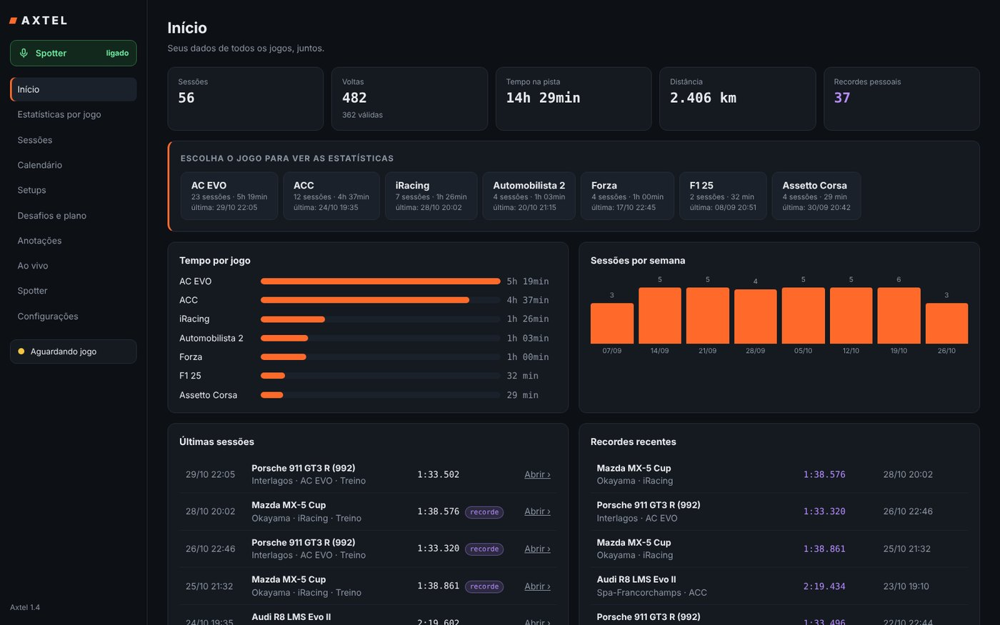
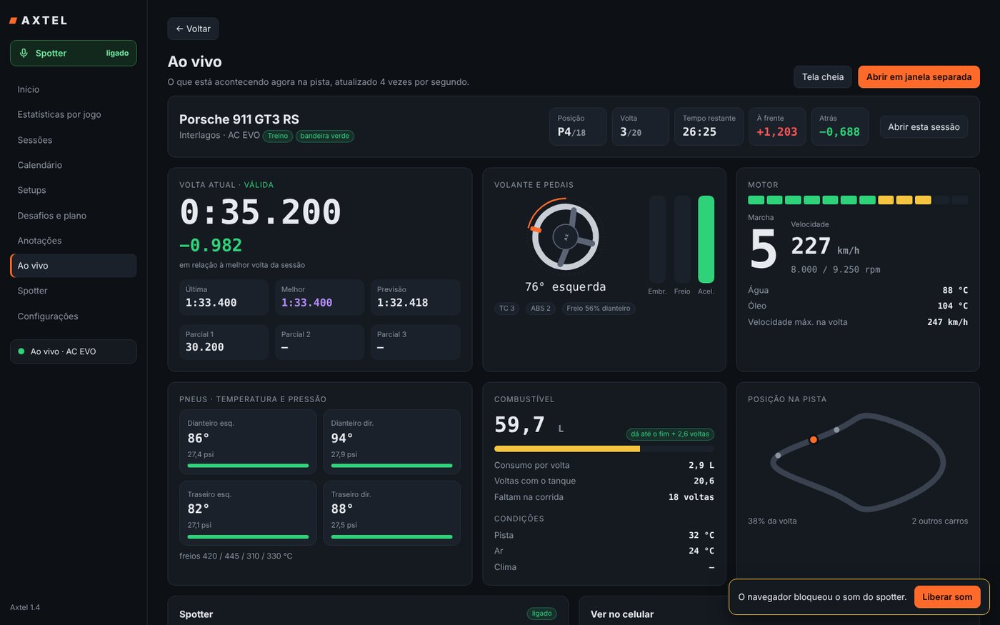
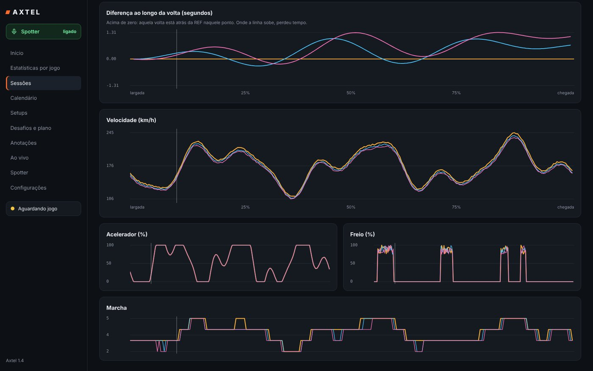
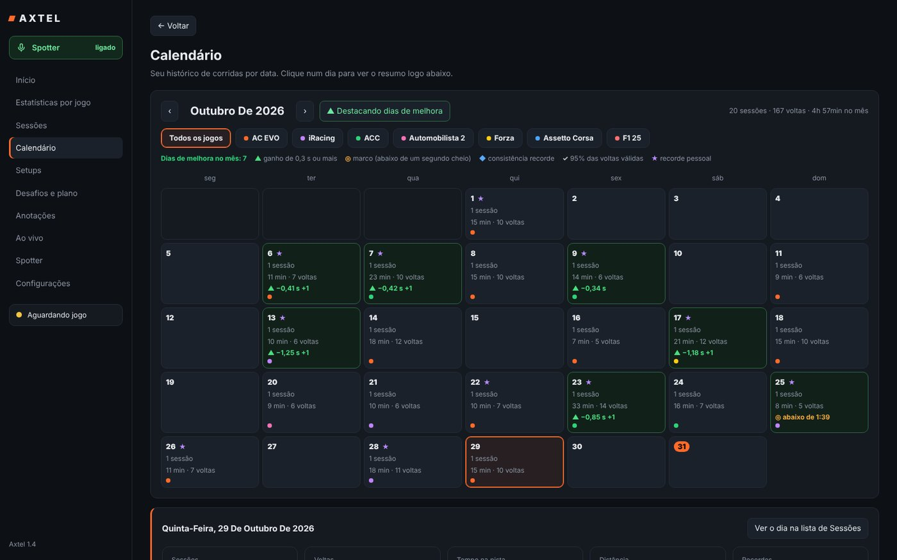
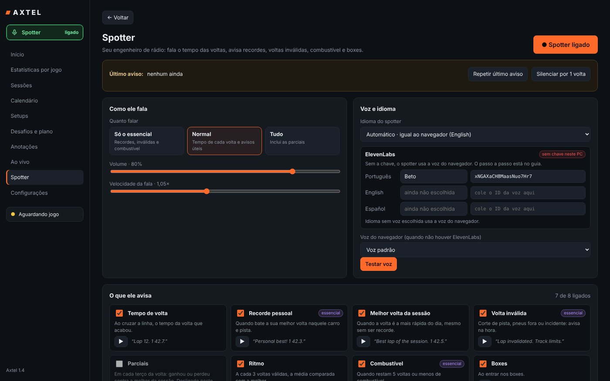

# Axtel — telemetria de sim racing

Grava sozinho todas as suas sessões e voltas, mostra tudo **ao vivo** enquanto você pilota, compara voltas para achar onde você perde tempo e tem um **spotter de voz em português**. Roda no seu PC com Windows e abre no navegador, também pelo celular.



> As imagens usam um histórico de exemplo. [Veja o vídeo de apresentação](docs/video-promocional.mp4).

## Jogos

| Jogo | Precisa configurar? |
|---|---|
| Assetto Corsa EVO | Não |
| Assetto Corsa | Não |
| Assetto Corsa Competizione | Não |
| iRacing | Não (já vem ligado; o Axtel confere em Configurações) |
| Automobilista 2 | No jogo: Opções › Sistema › Memória compartilhada = **Project CARS 2** |
| F1 25 | No jogo: Telemetria UDP ligada, IP `127.0.0.1`, porta `20777`, formato 2025 (ou o botão "Ajustar automaticamente") |
| Forza Motorsport / Horizon | No jogo: Data Out ligado, IP `127.0.0.1`, porta `5300` |

Em **Configurações › Telemetria dos jogos** o Axtel mostra, jogo por jogo, se está recebendo dados e o que falta ligar.

## O que ele faz

- **Ao vivo:** tempo da volta, diferença para a melhor, previsão, parciais, volante girando com o ângulo, pedais, luzes de RPM, pneus, combustível (e se dá até o fim), condições da pista e mapa com os outros carros. Abre numa janela separada para outro monitor.
- **Sessões e voltas:** tudo gravado sozinho, com voltas inválidas detectadas (pneus fora, boxes, incidentes, aviso do jogo).
- **Comparar voltas:** até 10 voltas no gráfico, cada uma de uma cor: diferença ao longo da volta, velocidade, acelerador, freio, marcha e replay no traçado.
- **Calendário:** seu histórico por dia, com os dias de melhora destacados.
- **Desafios e plano de treino**, **setups** por carro e pista e **anotações**.
- **Spotter de voz:** fala o tempo das voltas, recordes, voltas inválidas, combustível e boxes. Voz do navegador ou do ElevenLabs.
- **No celular:** abra o endereço que aparece na tela Ao vivo, no mesmo Wi-Fi.

| Ao vivo | Comparar voltas |
|---|---|
|  |  |
| **Calendário** | **Spotter** |
|  |  |

## Instalar

Precisa de Windows 10 ou 11. O Python é instalado sozinho, se faltar.

1. Em **[Releases](../../releases)**, baixe o `Axtel-v1.5.zip` mais recente.

2. Extraia o zip (botão direito › **Extrair tudo**) ou pelo PowerShell:
   ```powershell
   Expand-Archive -Path "$env:USERPROFILE\Downloads\Axtel-v1.5.zip" -DestinationPath "$env:USERPROFILE\Downloads" -Force
   ```

3. Dois cliques em **Instalar Axtel**, dentro da pasta extraída, ou pelo PowerShell:
   ```powershell
   powershell -NoProfile -ExecutionPolicy Bypass -File "$env:USERPROFILE\Downloads\Axtel\instalar.ps1"
   ```
   Ele copia o Axtel para `%LOCALAPPDATA%\Programs\Axtel`, cria atalhos na Área de Trabalho e no Menu Iniciar e abre o Axtel.

4. Se o PC não tiver Python, o Axtel pergunta se pode instalar o Python 3.12 (só para o seu usuário, sem pedir administrador). Clique em **Sim** e espere.

Na primeira vez, o Windows pode mostrar "O Windows protegeu o computador": clique em **Mais informações › Executar assim mesmo**. Se perguntar sobre a rede, marque **Redes privadas** e **Permitir** (é o que deixa o celular abrir o painel).

**Atualizar:** baixe o zip novo e rode o **Instalar Axtel** de novo. Seu histórico (pasta `dados`) não é tocado.
**Desinstalar:** Menu Iniciar › Axtel › **Desinstalar Axtel**, ou Configurações › Aplicativos.
**Sem instalar:** dá para usar direto da pasta extraída, com dois cliques no `Axtel.exe`.

O manual completo fica em `documentacao\Manual do Axtel.html`, dentro do pacote.

## Voz do spotter (opcional)

Sem configurar nada, o spotter usa a voz do navegador. Para usar uma voz do ElevenLabs, guarde a sua chave no Windows (ela fica só no seu PC) e abra o Axtel de novo:

```powershell
setx ELEVENLABS_API_KEY "cole-sua-chave-aqui"
```

Depois escolha as vozes na tela **Spotter**.

## Privacidade

Tudo fica no seu PC: o banco de dados, os backups e o log ficam na pasta `dados` do Axtel. O Axtel não manda nada para a internet, a não ser as frases do spotter para o ElevenLabs, se você ligar essa opção.

---

## Para desenvolvedores

Python 3.9+ só com a biblioteca padrão (sem `pip install`). O painel é HTML, CSS e JavaScript puros.

```
app/            o Axtel (axtel.py, axtel_app/ e painel/)
lancador/       Axtel.exe em Go: abre sem janela preta e instala o Python se faltar
instalador/     Instalar Axtel.bat, instalar.ps1, desinstalar.ps1
testes/         testes rápidos, simulador dos 7 jogos e validação completa com navegador
docs/           manual, imagens e vídeo
scripts/        empacotar.sh: monta o zip da versão em dist/
```

Rodar direto do código:

```powershell
python app\axtel.py
```

Testes rápidos (rodam no GitHub a cada envio, no Windows e no Linux):

```powershell
python -m unittest discover -s testes -v
```

Validação completa (simula os 7 jogos e clica em todos os botões do painel, no PC e no celular), que gera `testes/relatorio/index.html`:

```powershell
pip install playwright
python -m playwright install chromium
python testes\validar.py
```

**Lançar uma versão:** troque `VERSAO` em `app/axtel_app/servidor.py`, registre no `CHANGELOG.md` e envie uma tag (`git tag v1.5 && git push --tags`). O GitHub compila o `Axtel.exe`, monta o zip e cria a Release sozinho. Para montar o zip localmente: `bash scripts/empacotar.sh`, que precisa de Go para o `Axtel.exe`.

## Avisos

Assetto Corsa, Assetto Corsa Competizione, Assetto Corsa EVO, iRacing, Automobilista 2, F1 25 e Forza são marcas dos seus donos. O Axtel é um projeto independente, sem ligação com eles. Ele só lê a telemetria que os próprios jogos publicam.

## Licença

© 2026 Leonardo Axiole. Uso pessoal gratuito; veja [LICENSE](LICENSE).
